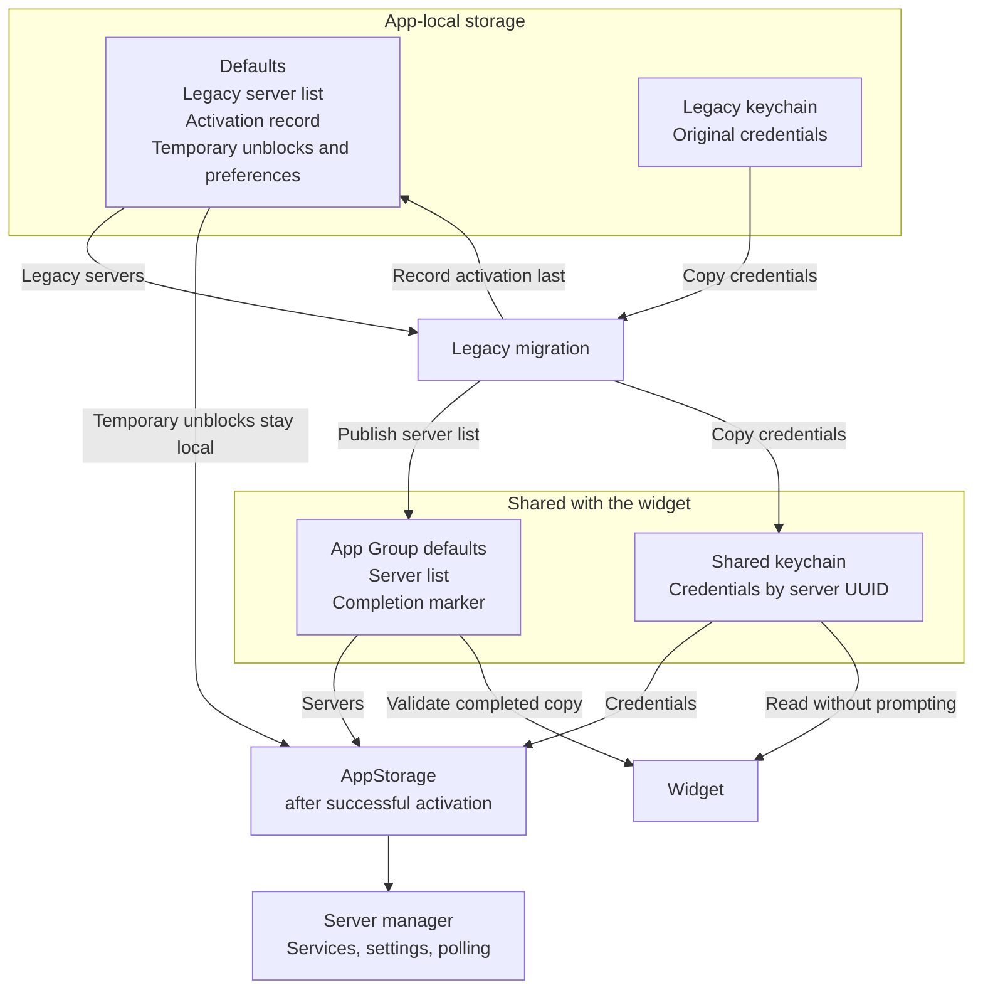
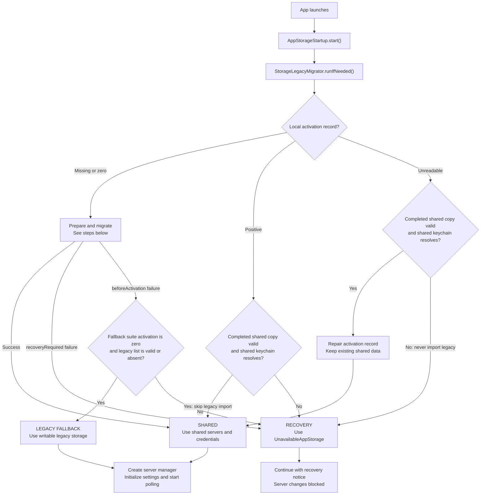
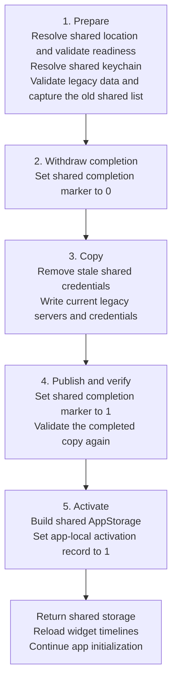

# App Storage and Keychain Migration

## Why

The widget work planned for after the v1.3.0 release needs access to the app's saved Pi-hole connections. The widget runs in a separate extension process, so it needs an App Group defaults suite and a shared keychain access group.

Migration copies server configurations and credentials into those shared stores. Secrets stay in Keychain; defaults hold configuration and markers. Temporary-unblock records and app preferences stay local. Existing connections must remain usable if migration cannot finish before activation, and stale legacy data must never replace shared data after activation.

This document describes the current implementation, including startup, retries, credential cleanup, and widget reads. The diagrams show logical reads and writes, not a single atomic transaction across defaults and keychain.

## Storage locations

| Store | Contents | Role |
| --- | --- | --- |
| App-local defaults | Legacy server list, activation record, temporary-unblock records, preferences | Source before activation; local records and preferences remain here afterward. |
| Legacy keychain | Original credentials, keyed by server UUID | Credential source before activation; originals remain after copying. |
| App Group defaults | Shared server list and completion marker | Server storage after activation; readable by the widget when ready. |
| Shared keychain | Copied credentials, keyed by the same server UUID | Credential storage for the app and widget after activation. |

During legacy fallback, `ConcreteAppStorage` uses app-local defaults for servers and the legacy keychain for credentials. Temporary-unblock records still use the injected app-local suite.

### Keychain configuration

| Setting | Legacy keychain | Shared keychain |
| --- | --- | --- |
| Service | App bundle identifier | Containing app identifier plus `.shared` |
| Access group | No explicit group | `HoleberryKeychainAccessGroup` bundle metadata |
| Data Protection Keychain selection | Disabled | Enabled |
| Account key | Server UUID string | Same server UUID string |
| Authentication prompts | Allowed in the app | Allowed in the app; disabled in the widget |

Both targets derive the shared service from `HoleberryContainingAppIdentifier`. The widget must use the containing app's identifier, rather than its own extension identifier. The defaults suite comes from `HoleberryAppGroupIdentifier`. Missing, blank, or unexpanded metadata throws instead of silently selecting a different store. The App Group identifier must also start with `group.` and have a nonempty suffix. Access-group and containing-app identifier syntax is not otherwise validated.

Resolving a keychain handle does not prove that every credential can be read. During copying, an error reading or writing an individual credential fails the copy; absence returns `nil` and is handled as a passwordless server.

## Completion and activation are separate

| Marker | Location | Meaning |
| --- | --- | --- |
| `sharedStorageMigrationVersion` | App Group defaults | A complete shared copy is published. Missing or `0` is pending; the supported completed version is `1`. |
| `sharedStorageActivatedVersion` | App-local defaults | The app has switched authority to shared storage. Missing or `0` permits first activation; any positive integer records prior activation. |

A completed copy can exist before activation, for example after an interrupted launch. While activation is zero, legacy storage remains authoritative. The next migration refreshes the shared copy from current legacy data, including edits made during fallback.

These markers use storage versions, separate from the app's release version.

Negative or malformed activation records are unreadable history. They never permit legacy import or fallback. Booleans and floating-point values are rejected as versions: coercion could falsely report completion, while treating corruption as zero could replay legacy data.

## Startup decision

`AppDelegate` creates one set of legacy dependencies and injects a `StorageLegacyMigrator` into `AppStorageStartup`. The startup object calls `runIfNeeded()` once and maps its result or failure into a launch outcome.

This happens synchronously on the main actor before the server manager, settings, and polling are initialized. A migration failure returns fallback or recovery so the remaining app initialization can continue.

Before returning writable fallback, startup independently checks the fallback suite's activation record and server list. This prevents a separately injected migrator from enabling writes to a legacy domain that has already activated shared storage. An absent list is valid for a fresh install; a malformed list is not.

### Failure handling

| Failure point | Outcome |
| --- | --- |
| Shared location or shared keychain cannot resolve with zero activation | `beforeActivation`; startup may use validated legacy fallback. |
| Initial shared validation throws, including corrupt or unsupported completion evidence | `recoveryRequired`; preserve the shared evidence. |
| The copy engine throws, including a credential failure or malformed unpublished shared list | `beforeActivation`; fallback still requires zero activation and a valid legacy list. |
| Final shared validation throws / reports pending | Throws: recovery. Pending: eligible for validated legacy fallback. |
| Shared preparation fails with positive or unreadable activation history | Recovery; no legacy import or fallback. |

Unexpected migrator errors also produce recovery. Startup unwraps typed migration failures so the app can log the original cause. The setup notice shows a fixed message based on startup status. If fallback validation itself fails, the app logs that validation error instead.

## Migration order

Migration runs when activation is missing or zero, even if the shared completion marker is already `1`. A fresh install follows the same path with an empty legacy list.

The copy engine retains the old shared list from its validated snapshot. It uses that list to remove credentials for servers absent from current legacy storage. It does not read a different shared list after withdrawing completion. A missing list is valid for a pending copy; a malformed pending list blocks copying because cleanup cannot safely determine the old server IDs.

The engine then writes the legacy server list and copies each credential. If a legacy credential is absent, it deletes any earlier shared credential for that UUID. Credential errors propagate; they are not treated as passwordless connections.

Completion is published only after those writes finish. The migrator then validates readiness again, builds the shared storage adapter, and records activation last. Once activation is positive, later launches validate shared storage and skip legacy import.

### Retry and interruption

Legacy server configurations and credentials are retained during migration. Temporary-unblock records are never copied into the App Group.

If copying fails after completion is withdrawn, the shared marker remains zero. Validated legacy storage can serve that launch, and a later launch retries from current legacy data. If copying completed but activation was never recorded, the next launch still refreshes from legacy before activating.

If shared-keychain resolution fails before copying starts, the app leaves any completed shared copy published and may use legacy fallback. The widget can therefore read an older shared copy while fallback edits remain local. This is existing policy: a later successful migration refreshes the shared copy before activation. The completion marker describes publication, not whether shared data matches every later fallback edit.

Positive activation changes the rule: missing, invalid, or inaccessible shared storage requires recovery. The app never repairs that situation by importing old legacy data. Unreadable activation history can be repaired only after an existing completed shared copy validates and the shared keychain resolves.

## After startup

| Launch mode | Storage used | App behavior |
| --- | --- | --- |
| Shared | Shared servers and credentials; local temporary-unblock records | Server changes are enabled. First activation or activation repair reloads widget timelines; later persisted connection changes also request reloads. |
| Legacy fallback | Local servers, legacy credentials, local temporary-unblock records | Server changes are enabled. Changes remain in legacy storage until a later migration succeeds. |
| Recovery | `UnavailableAppStorage` | The app continues with a setup notice and no loaded connections. Server changes are blocked; the adapter refuses writes. |

The widget does not run migration or read the app's legacy stores. It resolves shared storage without prompting, checks readiness before fetching statistics, logs out, and checks readiness and server configuration again before returning results. Missing readiness or shared setup errors produce a setup-required entry. Its on-demand manager disables server changes and temporary-unblock persistence; the widget's own defaults suite is separate from the containing app's local defaults.

### Credential deletion

Successful migration does not purge legacy originals. Clearing a saved password deletes only the active credential. Explicitly removing a migrated connection deletes the legacy credential first, then the active shared credential, then the server configuration. A failure stops that sequence. During legacy fallback, removal uses the active legacy keychain only.

## Implementation reference

| Responsibility | Source |
| --- | --- |
| Composition and launch outcome | [HoleberryApp.swift](../Sources/Holeberry/App/HoleberryApp.swift), [AppStorageStartup.swift](../Packages/HoleberryCore/Sources/HoleberryCore/Persistence/AppStorageStartup.swift) |
| Activation, copying, and legacy validation | [StorageLegacyMigrator.swift](../Packages/HoleberryCore/Sources/HoleberryCore/Persistence/Migration/StorageLegacyMigrator.swift), [StorageLegacyCopyEngine.swift](../Packages/HoleberryCore/Sources/HoleberryCore/Persistence/Migration/StorageLegacyCopyEngine.swift), [StorageLegacyStore.swift](../Packages/HoleberryCore/Sources/HoleberryCore/Persistence/Migration/StorageLegacyStore.swift) |
| Persisted keys and snapshot validation | [DefaultsKeys.swift](../Packages/HoleberryCore/Sources/HoleberryCore/Persistence/DefaultsKeys.swift), [PersistedStartupValue.swift](../Packages/HoleberryCore/Sources/HoleberryCore/Persistence/PersistedStartupValue.swift), [SharedStorageValidation.swift](../Packages/HoleberryCore/Sources/HoleberryCore/Persistence/SharedStorageValidation.swift) |
| Storage adapter and keychain configuration | [AppStorage.swift](../Packages/HoleberryCore/Sources/HoleberryCore/Persistence/AppStorage.swift), [KeychainManager.swift](../Packages/HoleberryCore/Sources/HoleberryCore/Persistence/KeychainManager.swift), [Bundle+Extensions.swift](../Packages/HoleberryCore/Sources/HoleberryCore/Utils/Bundle+Extensions.swift) |
| Widget reads | [QueryStatisticsProvider.swift](../Sources/HoleberryWidgets/QueryStatisticsProvider.swift) |

Regression coverage lives in [AppStorageStartupTests.swift](../Packages/HoleberryCore/Tests/HoleberryCoreTests/AppStorageStartupTests.swift), [StorageLegacyMigratorTests.swift](../Packages/HoleberryCore/Tests/HoleberryCoreTests/Utils/StorageLegacyMigratorTests.swift), and [SharedStorageMigrationTests.swift](../Packages/HoleberryCore/Tests/HoleberryCoreTests/Utils/SharedStorageMigrationTests.swift). These cover fallback and recovery, activation write order, refresh after fallback, and use of the validated snapshots. They do not establish that every signed historical installation can import its keychain items without user interaction.
