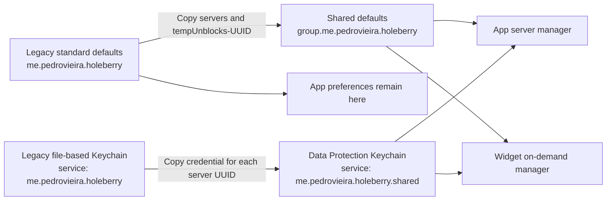

# UserDefaults and Keychain migration: current implementation

Read the before/after tables first, then the failure matrix before changing the migration policy.

**Snapshot:** PR #59, commit `8229361e4c2defbab975dbc04dfba2de39c79ea2`, investigated on 2026-11-14. This report describes the code that exists, including its limitations. The changes discussed in the PR-comment investigation have not been implemented.

**Scope:** application-owned defaults, server credentials, shared-storage identifiers, startup selection, and widget access. This is a source-code investigation; no real user defaults or saved credentials were read. Example UUIDs below are invented. Translation pending: this technical report is English-only.

## 1. What changed

Before widgets, the app stored server configuration and temporary-unblock records in its standard UserDefaults domain. It stored each server's credential in the legacy macOS Keychain under the app's bundle identifier.

The new app copies those records into shared defaults and a shared Keychain namespace before constructing the server manager. The app and widget then use those shared stores for server connections. Ordinary app preferences remain in standard defaults. The original server data and credentials are preserved; this is a copy and a change of active stores, not a destructive move. The standard defaults domain gains a new activation marker. [Composition root][app] · [Migration implementation][migration] · [Keychain implementation][keychain]



### 1.1 Application and sharing identifiers

| Identifier | Before | Current branch | Purpose |
| --- | --- | --- | --- |
| App bundle identifier | `me.pedrovieira.holeberry` | Unchanged | App identity and legacy defaults/Keychain namespace |
| Widget bundle identifier | No widget | `me.pedrovieira.holeberry.widgets` | Separate extension identity; not the shared credential service |
| App Group identifier | No shared storage in this path | `group.me.pedrovieira.holeberry` | Shared defaults/container authorization |
| Shared Keychain access group | No explicitly selected group in legacy queries | `$(AppIdentifierPrefix)me.pedrovieira.holeberry.shared` | Authorizes app and widget to access the same credentials |
| Shared Keychain service | Not present | `me.pedrovieira.holeberry.shared` | Groups the new server-credential items within Keychain |

The access-group build setting is expanded during signing. The repository does not supply a literal signing prefix here. The release workflow expects `<HOLEBERRY_TEAM_ID>.me.pedrovieira.holeberry.shared`. The exact prefix for a signed artifact must be read from its expanded metadata and entitlements; it should not be guessed from the bundle identifier. An App Group identifier, a Keychain access group, and a Keychain service are separate identifiers even though their names are similar. [Project configuration][project] · [App entitlements][app-entitlements] · [Widget entitlements][widget-entitlements] · [Release validation][release]

### 1.2 Metadata carried by both bundles

| Info.plist key | Configured value | Used for |
| --- | --- | --- |
| `HoleberryAppGroupIdentifier` | `group.me.pedrovieira.holeberry` | Opening the shared defaults suite |
| `HoleberryKeychainAccessGroup` | `$(AppIdentifierPrefix)me.pedrovieira.holeberry.shared` | Constructing the shared Keychain client |
| `HoleberryContainingAppIdentifier` | `$(HOLEBERRY_APP_BUNDLE_IDENTIFIER)` → `me.pedrovieira.holeberry` | Keeping the shared service identical in the app and widget |

Current validation rejects missing, blank, and unexpanded App Group/access-group metadata. App Group validation additionally checks the `group.` prefix; it does **not** prove registration or entitlement authorization. Containing-app metadata currently behaves differently: missing, blank, or unexpanded values fall back to the running process's bundle identifier. In a widget, that can incorrectly select `me.pedrovieira.holeberry.widgets.shared`. This is existing behavior, not the proposed no-fallback policy. [Bundle metadata implementation][bundle]

## 2. UserDefaults: old and new locations

| Store | API / persistent domain | Contents after successful migration |
| --- | --- | --- |
| Standard defaults | `UserDefaults.standard`; app domain `me.pedrovieira.holeberry` | Existing app preferences, preserved legacy servers/records, and the new local activation marker |
| Shared defaults | `UserDefaults(suiteName: "group.me.pedrovieira.holeberry")`; domain `group.me.pedrovieira.holeberry` | Active server configurations, active per-server temporary records, and the migration completion marker |

The server-related **key names do not change**. Their suite changes. Calling `.servers()` without a suite still means standard defaults; `.servers(suite: sharedSuite)` means the shared domain. Correct constructor injection is therefore part of the migration. The production app passes `appStorage.suite` to `PiholeServerManager`; the service factory passes the same suite into temporary-unblock persistence. The widget opens that shared suite and passes it to its own manager. [Typed keys][defaults] · [Composition root][app] · [Service factory][factory] · [Widget provider][provider]

### 2.1 Filesystem location versus storage identity

For the non-sandboxed app, the conventional standard preference file is `~/Library/Preferences/me.pedrovieira.holeberry.plist`. The App Group container is conventionally under `~/Library/Group Containers/group.me.pedrovieira.holeberry/`, with shared preferences associated with the group domain in its `Library/Preferences` area. These are orientation paths, not paths hardcoded or opened by Holeberry. Their contents were not inspected for this report.

The code addresses a **defaults domain**, not a plist file. macOS manages backing files and preference caching. Apple's supported way to resolve a group directory is `FileManager.containerURL(forSecurityApplicationGroupIdentifier:)`; the migration itself uses the suite API, not that directory API. A typed readback or an in-process persistent-domain readback is not proof that bytes have reached disk. [Defaults implementation][defaults] · [Apple: UserDefaults][apple-defaults] · [Apple: group-container location][apple-container]

## 3. Exactly what is copied

| Data | Source | Destination | Identity preserved |
| --- | --- | --- | --- |
| Server configurations | Standard key `servers` | Shared key `servers` | Every server UUID and configuration field |
| Temporary-unblock records | Standard key `tempUnblocks-<SERVER-UUID>` | Same key in shared defaults | Complete record arrays for configured legacy servers |
| Server credentials | Legacy Keychain service, account `<SERVER-UUID>` | Shared Keychain service/access group, same account | Exact credential string and server UUID |

Migration follows the list in `servers`. It does not enumerate every defaults key or every Keychain item. An old temporary-record key or credential whose UUID is absent from the legacy server list is not imported. The routine does not copy unrelated preferences, widget aggregate statistics, browser session data, or network sessions. [Migration implementation][migration]

### 3.1 Server fields

The `servers` array contains `ServerConfig` values. Migration copies `id`, `label`, `icon`, `url`, and `version`. It preserves order and verifies all fields on readback. The migration uses an explicit field comparison because `ServerConfig` equality compares only IDs; equality alone would miss a changed URL, icon, label, or API version. Credentials are not fields in this defaults model. [Server model][server] · [Migration field comparison][migration]

### 3.2 Temporary-unblock fields

| Fields | Meaning |
| --- | --- |
| `domain`, `uuid` | Domain and identity of the temporary record |
| `startDateUTC`, `durationSeconds` | Start time and duration |
| `pendingRemoval`, `retryCount` | Cleanup state and retry history |

All fields are copied, including pending removal and retries. A server UUID identifies the defaults key; the record's `uuid` identifies an individual record inside the array. Those are different IDs. No new UUID is generated during migration. [Temporary record model][temp-record] · [Migration][migration]

### 3.3 An example across both storage systems

For an invented server ID `11111111-2222-4333-8444-555555555555`:

```text
BEFORE
  Defaults domain: me.pedrovieira.holeberry
    servers: contains ServerConfig with that ID
    tempUnblocks-11111111-2222-4333-8444-555555555555: record array

  Legacy Keychain
    class: generic password
    service: me.pedrovieira.holeberry
    account: 11111111-2222-4333-8444-555555555555
    value: <credential; never included in this report>

AFTER
  Defaults domain: group.me.pedrovieira.holeberry
    servers: copied ServerConfig with the same ID
    tempUnblocks-11111111-2222-4333-8444-555555555555: copied record array
    sharedStorageMigrationVersion: 1

  Data Protection Keychain
    class: generic password
    service: me.pedrovieira.holeberry.shared
    access group: <expanded prefix>me.pedrovieira.holeberry.shared
    account: 11111111-2222-4333-8444-555555555555
    value: <same credential>

  Original defaults and credential remain.
  Standard defaults additionally contain sharedStorageActivatedVersion: 1.
```

This is a logical representation, not the serialized plist layout. Serialization is handled by the Defaults library. [Typed keys][defaults] · [Keychain account mapping][keychain]

## 4. Complete inventory of application-owned defaults

There are **16 typed key factories**: two migrated data families, twelve existing app preference/state keys that stay standard, and two new migration markers. Tables below list the defaults when no value has been stored. They do not imply that every default has been written to disk. [Key definitions and defaults][defaults]

### 4.1 Migrated server data

| Key | Type | Default | Migration / active location |
| --- | --- | --- | --- |
| `servers` | `[ServerConfig]` | `[]` | Copied standard → shared; active app/widget managers use shared |
| `tempUnblocks-<SERVER-UUID>` | `[TempUnblockRecord]` | `[]` | Copied standard → shared for each configured legacy server |

### 4.2 General and browser preferences: stay standard

| Key | Type | Default | Migration |
| --- | --- | --- | --- |
| `launchAtLogin` | `Bool` | `false` | Not copied; stays standard |
| `browserTabUnblockEnabled` | `Bool` | `false` | Not copied; stays standard |
| `showAllClientsRecentBlocked` | `Bool` | `false` | Not copied; stays standard |
| `showPerInstanceStats` | `Bool` | `true` | Not copied; stays standard |
| `showGravityMenuItem` | `Bool` | `true` | Not copied; stays standard |

Launch-at-login also depends on the operating system's `SMAppService` state. Settings reconciles its stored preference with that actual state. Moving a defaults value would not itself move or register a login item. [Settings implementation][settings]

### 4.3 Notification preferences: stay standard

| Key | Type | Default | Migration |
| --- | --- | --- | --- |
| `notifyWhenUnblockEnds` | `Bool` | `true` | Not copied; stays standard |
| `notifyWhenDomainUnblockEnds` | `Bool` | `true` | Not copied; stays standard |
| `notifyGravityUpdateCompleted` | `Bool` | `true` | Not copied; stays standard |

These preferences control application behavior. macOS notification authorization is a separate OS permission and is not migrated. The composition root explicitly constructs `NotificationCoordinator` with `.standard`. [Composition root][app] · [Notification settings][notification-settings]

### 4.4 Durations and Gravity scheduling: stay standard

| Key | Type | Default | Migration |
| --- | --- | --- | --- |
| `unblockDurations` | `[UnblockDurationEntry]` | 10 s, 30 s, 300 s, in that order | Not copied; stays standard |
| `unblockCurrentTabDuration` | `UnblockCurrentTabDurationSelection` | `.entry(default5mID)` | Not copied; stays standard |
| `gravityUpdateCadence` | `GravityUpdateCadence` | `.never` | Not copied; stays standard |
| `gravityUpdateNextDue` | `Date?` | `nil` | Not copied; stays standard |

Default duration entries have stable IDs: 10 seconds uses `00000000-0000-4000-8000-00000000000A`; 30 seconds uses `00000000-0000-4000-8000-00000000001E`; 5 minutes uses `00000000-0000-4000-8000-00000000012C`. These are duration-choice IDs, not server or migration IDs. The current-tab selection refers to the 5-minute entry by ID. If that reference becomes invalid, the selection can heal to `.indefinite`. [Duration entries][durations] · [Current-tab selection][tab-duration] · [Shortcut controller][shortcuts]

### 4.5 New control metadata

| Key | Default | Actual location | Purpose |
| --- | --- | --- | --- |
| `sharedStorageMigrationVersion` | `0` | Shared defaults | Records the completed migration generation; widget checks it |
| `sharedStorageActivatedVersion` | `0` | Standard defaults | Remembers that this app activated the current migration generation |

These are newly created markers, not old user settings being copied. The current migration generation is `1`. Both key factories default to `.standard` if called without a suite, but their production call sites explicitly use the locations above. [Migration markers][migration] · [Startup selection][startup]

### 4.6 Settings and state outside this typed-key inventory

| Setting/state | Owner | Included in migration? |
| --- | --- | --- |
| Keyboard shortcut bindings | KeyboardShortcuts dependency, addressed by shortcut names | No; migration does not enumerate or copy the dependency's keys |
| Automatic update preferences | Sparkle updater APIs | No; separate from the twelve typed app preferences |
| Login-item registration | `SMAppService` | No; OS registration remains separate from `launchAtLogin` |
| Notification and automation authorization | macOS permission services | No; not represented as migrated preference values |
| Live statistics and authentication sessions | Managers/services and current fetch state | No; migration copies saved credential strings, not session state or widget totals |

The exact internal persistence keys of dependencies are not asserted here. The source confirms their public API use and that migration does not copy them. Shortcut names include `disableIndefinitely`, `disable10s`, `disable30s`, `disable5m`, `disableCustom`, `reEnableBlocking`, `unblockCurrentTab`, and `updateGravity`; custom durations use `unblockDuration-<ENTRY-UUID>`. The three legacy duration names are retained so existing bindings keep their identities. [Settings][settings] · [Shortcut names][shortcut-names] · [App composition][app] · [Widget provider][provider]

The Settings window also uses AppKit frame autosave with the name `Settings`; migration does not copy that window state. Sparkle's automatic-check checkbox uses `SPUUpdater.automaticallyChecksForUpdates`. The build's `SUEnableAutomaticChecks: true` is an initial configuration value, not proof that a user's saved preference is currently true. [Settings window controller][settings-window] · [Updater wrapper][updater] · [Project configuration][project]

## 5. Keychain: old and new item identities

### 5.1 Namespace and physical storage selection

| Attribute | Legacy reader/writer | Shared reader/writer |
| --- | --- | --- |
| Item class (`kSecClass`) | `kSecClassGenericPassword` | Same |
| Service (`kSecAttrService`) | `me.pedrovieira.holeberry` for the production app | `me.pedrovieira.holeberry.shared` with valid metadata |
| Account (`kSecAttrAccount`) | `serverID.uuidString` | Same server UUID string |
| Access group (`kSecAttrAccessGroup`) | Not explicitly included in the query | Expanded shared access group |
| `kSecUseDataProtectionKeychain` | Not set | `true` |

Before the PR, `KeychainManager()` used the main bundle identifier as service and created no access-group or Data Protection query attributes. The PR preserves that legacy query in the default initializer specifically so it can still read existing credentials. The new `KeychainManager.shared(...)` selects a different service, an explicit access group, and the Data Protection Keychain. [Current implementation][keychain] · [Pre-widget implementation][legacy-keychain]

On macOS, SecItem queries default to the file-based Keychain when neither Data Protection nor synchronization is requested. The old query therefore targets the legacy file-based system, typically the user's login Keychain. The new flag selects the user's Data Protection Keychain. Keychain Access may label that store **Local Items** or **iCloud**, depending on system settings. The code does not hardcode a Keychain database path. [Apple: macOS Keychain implementations][apple-keychains]

The conventional legacy login file is `~/Library/Keychains/login.keychain-db`, but the old query uses the system search list/default Keychain rather than explicitly choosing that file. The shared credential is **not** a file inside the App Group container. Data Protection Keychain storage is managed by macOS. A service name is an item attribute, not a filename. [Apple: macOS Keychain implementations][apple-keychains]

### 5.2 Accessibility and interaction

| Behavior | Legacy migration reader | Shared app client | Shared widget client |
| --- | --- | --- | --- |
| Authentication context | Interactive | Interactive | `interactionNotAllowed = true` |
| Localized reason | App's saved-password reason | Same | Same reason configured, but interaction prohibited |
| Synchronizable items requested | No | No | No |
| New Data Protection item accessibility | Not applicable to the legacy file-based query | Dependency default `.afterFirstUnlock` | Same store/attributes |

SimpleKeychain 1.3.0 supplies generic-password queries and defaults `synchronizable` to false. With Data Protection selected, it sets the accessibility attribute to its default `.afterFirstUnlock` when creating an item. Holeberry does not add biometric access-control flags. Setting the Data Protection flag alone does **not** enable iCloud synchronization. “Interactive” permits authentication UI when required; it does not mean every operation necessarily prompts. [SimpleKeychain implementation at 1.3.0][simple-keychain] · [Holeberry wrapper][keychain] · [Apple: synchronization attribute][apple-sync]

### 5.3 Copying credentials

For each configured legacy server, migration asks the legacy Keychain for the item with that server UUID account. `readCredential` first checks existence, then reads the string. If present, migration saves the same string in the shared namespace and requires exact readback equality. The credential can be the existing Pi-hole authentication material supplied by the app; migration treats it as an opaque string.

If the legacy item is absent, migration removes any corresponding shared item and verifies that it is absent. Absence is accepted; a thrown read/access error is treated as import failure. It never prints the credential or stores it in defaults. Successful copying does not delete the legacy item. [Credential-copy and removal routines][migration] · [Keychain reads/writes][keychain]

## 6. Startup and migration sequence

### 6.1 Before creating the server manager

1. The app constructs its legacy standard suite and legacy Keychain reader, then validates App Group and access-group metadata.
2. It constructs the shared Keychain client and resolves the shared defaults suite. Resolution happens on every launch, including launches already marked activated.
3. If the standard activation marker is already at least the current generation, startup selects shared storage without invoking migration. Otherwise, it calls migration with the resolved suite.
4. A successful migration return causes startup to write the standard activation marker and select the shared stores. The app then creates its manager from those stores.
5. When startup reports a migration on this launch, the app requests widget timeline reloads. Later manager persistence changes request reloads through its callback.

These operations happen before the application-mode manager loads servers. `didMigrate` means that startup invoked the migration path successfully; it does not prove that legacy data was imported on that invocation. Migration can no-op on an existing completion marker or complete by resetting to empty. [Composition root][app] · [Startup selection][startup]

### 6.2 What migration generation 1 does

1. Read the shared completion version. Return immediately if it already meets the requested target. Only a zero completed version imports legacy state.
2. Strictly decode the legacy server array and each configured server's temporary-record array. Missing keys mean empty arrays; present malformed values fail instead of being silently accepted as partial data.
3. Remove shared temporary records and credentials for previously shared server IDs that are absent from the authoritative legacy list. Verify this cleanup.
4. Copy the server array and verify every field through a read of the shared persistent domain. For each server, copy and verify temporary records, then copy/verify its credential or verify its absence.
5. Write the shared completion marker and read it back. If its value is below the target, attempt to restore the previous generation and throw. After migration returns, startup writes activation in standard defaults.

The imported arrays are verified through the actual persistent domain so registered fallback defaults cannot masquerade as a saved empty array. This remains an in-process persistence check, not a transaction across defaults and Keychain and not a disk-durability guarantee. Completion/activation marker handling is different: completion uses a typed readback, and activation is written without a readback check. [Migration][migration] · [Strict persisted-array decoding][defaults]

### 6.3 Future generations

`currentVersion` is currently `1`. The migration implementation has an internal target-version entry point used by tests. If the existing completion version is greater than zero but below a newer target, it currently advances the marker without importing legacy state again. There are no implemented generation-specific transformations beyond the initial import. This avoids overwriting post-migration edits with stale legacy data; a future actual data transformation still needs its own implementation. [Version logic and tests][migration-tests] · [Migration][migration]

## 7. Failure behavior and next-launch behavior

### 7.1 Outcomes currently implemented

| Event | Current launch | Markers / next launch |
| --- | --- | --- |
| Import and readback succeed | Use populated shared stores | Completion and activation reach 1; subsequent launches use shared |
| Legacy import fails, but empty shared-server reset verifies | Use real shared stores with no configured servers | Completion and activation reach 1; **legacy import will not retry automatically** |
| Empty reset fails or completion-marker verification fails | Startup selects unavailable adapters | Activation is not newly written; migration may run again next launch if current generation is not activated |
| Metadata or suite resolution fails | Startup selects unavailable adapters | Next launch attempts setup again; it does not use legacy data for this launch |
| Activation already current but shared suite later resolves empty | Startup uses that resolved suite without rerunning migration | Standard activation skips migration; widget still checks shared completion and may show setup required |

The important distinction is between **failed import with successful empty recovery**, which counts as completion, and **failed storage setup/recovery**, which produces unavailable storage. The former is not a retry-on-next-launch policy. The legacy source remains, but current code deliberately stops importing it once completion/activation succeeds. [Migration recovery][migration] · [Startup selection][startup] · [Widget completion gate][provider]

### 7.2 How failed-import recovery works

`discardPartialImport()` takes IDs from the current shared server array, writes an empty shared server array, and verifies the empty saved value. It then writes empty temporary-record arrays for those IDs and attempts shared credential removal. The original legacy stores are left intact.

There are two current verification gaps: the temporary-record reset in this recovery function has no readback, and errors from credential removal are ignored with `try?`. Migration can therefore mark completion while orphaned records or credentials remain. The server list itself has been verified empty, so this does not mean partial servers are deliberately shown. Cleanup targets are discovered from the current server array, not by enumerating every record key or Keychain item. [Recovery routine][migration]

This sequence also matters for a future fix: simply propagating deletion errors after clearing `servers` loses the IDs needed for a later cleanup attempt. A retry-safe design must retain those IDs or complete adjacent cleanup before removing their references. This is an identified limitation, not an implemented change.

### 7.3 What “unavailable” currently means

The app does not continue on the original legacy stores. It constructs `UnavailableDefaults` and `UnavailableKeychain`. The former makes ordinary key reads empty and key writes no-ops; the latter throws for credential operations. Ordinary app preferences still use their standard suite. The app keeps running with an empty manager. [Unavailable defaults][defaults] · [Unavailable Keychain][keychain] · [Storage context][app]

The server manager currently has no storage-availability guard. A reachable passwordless server can be added in memory because credential deletion errors are ignored and defaults writes silently disappear. The sheet can report success even though that connection will not survive restart. This is the false-save issue in the PR review. The unavailable-defaults adapter also leaves inherited domain APIs exposed; its broad no-storage contract is stronger than its current overrides. [Manager mutation path][manager] · [Connection sheet][connection-sheet]

`AppStorageStartup.select` discards the caught error. Metadata and migration errors have other logs in the composition root, but a resolver error can reach only the generic unavailable log. The proposed fail-hard identity validation, removal of unavailable adapters, and revised fallback policy are still pending; this report does not assume which real store should be used after failure. [Startup catch][startup] · [Composition root][app]

## 8. After migration: app and widget access

| Component | Defaults | Credentials / behavior |
| --- | --- | --- |
| App server manager | Resolved shared suite in a successful startup | Shared Keychain, interactive context |
| App preferences and notifications | Standard suite | Not part of credential sharing |
| Temporary-unblock decorator | Suite injected through service construction | App persists active temporary-record state there |
| Widget manager | Independently opens shared suite | Shared Keychain, noninteractive context, on-demand execution |
| Widget setup path | Requires valid setup and completed migration marker | Does not migrate or read the legacy Keychain |

The widget synchronizes its suite view, checks `SharedStorageMigration.isComplete`, reads configured servers, and fetches summaries independently of the app. It logs out its own clients after fetching. It does not persist aggregate statistics or import legacy data. Shared access lets a widget read credentials while the app is closed; it does not share a live login session between processes. [Widget provider][provider]

After migration, app edits update shared stores only. Legacy server data and credentials can become stale because there is no ongoing dual-write or synchronization. A pre-widget build would still read those old stores, so preserving legacy data is not a full downgrade synchronization strategy. Reopening an older build does not automatically see new shared-store edits. [Composition root][app] · [Manager persistence][manager] · [Migration][migration]

## 9. Signing and authorization requirements

Both bundles declare the same App Group and Keychain access group. The widget is sandboxed; the app's current entitlements do not enable App Sandbox. Both targets still need valid authorization for their shared groups. `REGISTER_APP_GROUPS: YES` is set in project configuration. The release pipeline installs separate app/widget provisioning profiles and checks each profile's application identifier, expiry, App Group, and Keychain group, then checks the signed artifacts' entitlements. [Project][project] · [Entitlements][app-entitlements] · [Widget entitlements][widget-entitlements] · [Release workflow][release]

An identifier string in Info.plist is not authorization by itself. Apple's guidance describes App Group authorization for existing macOS apps; runtime reads can fail even when string validation passes. No signed release or installed profiles were inspected in this investigation. [Apple: App Group container authorization][apple-app-groups]

The CI `build.keychain-db` is separate: it holds the signing certificate during release builds. It is not where users' Pi-hole credentials are migrated. [Release workflow][release]

## 10. Evidence and validation limits

The implementation and existing tests were read for this report. Earlier in this investigation, the following focused command passed **70 tests in 10 suites** against this unchanged code snapshot:

```sh
cd Packages/HoleberryCore
swift test --scratch-path /tmp/holeberry-pr59-build \
  --filter 'AppStorageStartup|SharedStorageMigration|QueryStatistics|RelativeAge|Bundle'
```

Migration tests cover field preservation, temporary records, credential copying and absence, malformed inputs, normal cleanup, empty recovery, marker failures, and future-generation behavior. Startup tests cover resolution/migration failures, activation, and unavailable selection. Those tests largely use isolated defaults and mocked Keychain behavior; passing them does not prove a signed app/widget can access real shared credentials. The review also identified incomplete failure-injection coverage for recovery cleanup and weak unavailable-store write assertions. [Migration tests][migration-tests] · [Startup tests][startup-tests] · [Bundle tests][bundle-tests]

This report adds documentation only. It does not run migration against an installed app, change real preferences, access credentials, alter signing, or implement a revised failure policy. The prior instruction to delete `docs/WIDGET.md` remains separate from this documentation-only step.

**Next action:** review section 7's failure matrix, then choose whether a failed import should continue using legacy storage or the real shared storage before implementation resumes.

[app]: ../../Sources/Holeberry/App/HoleberryApp.swift
[migration]: ../../Packages/HoleberryCore/Sources/HoleberryCore/Persistence/SharedStorageMigration.swift
[startup]: ../../Packages/HoleberryCore/Sources/HoleberryCore/Persistence/AppStorageStartup.swift
[defaults]: ../../Packages/HoleberryCore/Sources/HoleberryCore/Persistence/DefaultsKeys.swift
[keychain]: ../../Packages/HoleberryCore/Sources/HoleberryCore/Persistence/KeychainManager.swift
[bundle]: ../../Packages/HoleberryCore/Sources/HoleberryCore/Utils/Bundle+Extensions.swift
[project]: ../../project.yml
[app-entitlements]: ../../Sources/Holeberry/Support/Holeberry.entitlements
[widget-entitlements]: ../../Sources/HoleberryWidgets/Support/HoleberryWidgets.entitlements
[release]: ../../.github/workflows/release.yml
[server]: ../../Packages/HoleberryCore/Sources/HoleberryCore/Models/ServerConfig.swift
[temp-record]: ../../Packages/HoleberryCore/Sources/HoleberryCore/Services/Pihole/TempUnblockRecord.swift
[durations]: ../../Packages/HoleberryCore/Sources/HoleberryCore/Models/UnblockDurationEntry.swift
[tab-duration]: ../../Packages/HoleberryCore/Sources/HoleberryCore/Models/UnblockCurrentTabDurationSelection.swift
[manager]: ../../Packages/HoleberryCore/Sources/HoleberryCore/Services/Pihole/PiholeServerManager.swift
[factory]: ../../Packages/HoleberryCore/Sources/HoleberryCore/Services/Pihole/PiholeServiceFactory.swift
[provider]: ../../Sources/HoleberryWidgets/QueryStatisticsProvider.swift
[settings]: ../../Sources/Holeberry/Settings/SettingsView.swift
[settings-window]: ../../Sources/Holeberry/Settings/SettingsWindowController.swift
[updater]: ../../Sources/Holeberry/App/Updater/SoftwareUpdater.swift
[notification-settings]: ../../Sources/Holeberry/Settings/NotificationsSettingsView.swift
[shortcuts]: ../../Sources/Holeberry/Shortcuts/ShortcutController.swift
[shortcut-names]: ../../Sources/Holeberry/Shortcuts/ShortcutNames.swift
[connection-sheet]: ../../Sources/Holeberry/Settings/ConnectionViews/ConnectionSheet.swift
[migration-tests]: ../../Packages/HoleberryCore/Tests/HoleberryCoreTests/Utils/SharedStorageMigrationTests.swift
[startup-tests]: ../../Packages/HoleberryCore/Tests/HoleberryCoreTests/AppStorageStartupTests.swift
[bundle-tests]: ../../Packages/HoleberryCore/Tests/HoleberryCoreTests/Utils/BundleContainingAppTests.swift
[legacy-keychain]: https://github.com/pedrovieira/Holeberry/blob/b1d9ea18ef2ea18ea66943adf2f6514d77d55b51/Packages/HoleberryCore/Sources/HoleberryCore/Persistence/KeychainManager.swift
[simple-keychain]: https://github.com/auth0/SimpleKeychain/blob/1.3.0/SimpleKeychain/SimpleKeychain.swift
[apple-keychains]: https://developer.apple.com/documentation/technotes/tn3137-on-mac-keychains
[apple-sync]: https://developer.apple.com/documentation/security/ksecattrsynchronizable
[apple-defaults]: https://developer.apple.com/documentation/foundation/userdefaults
[apple-container]: https://developer.apple.com/documentation/foundation/filemanager/containerurl(forsecurityapplicationgroupidentifier:)
[apple-app-groups]: https://developer.apple.com/documentation/xcode/accessing-app-group-containers
